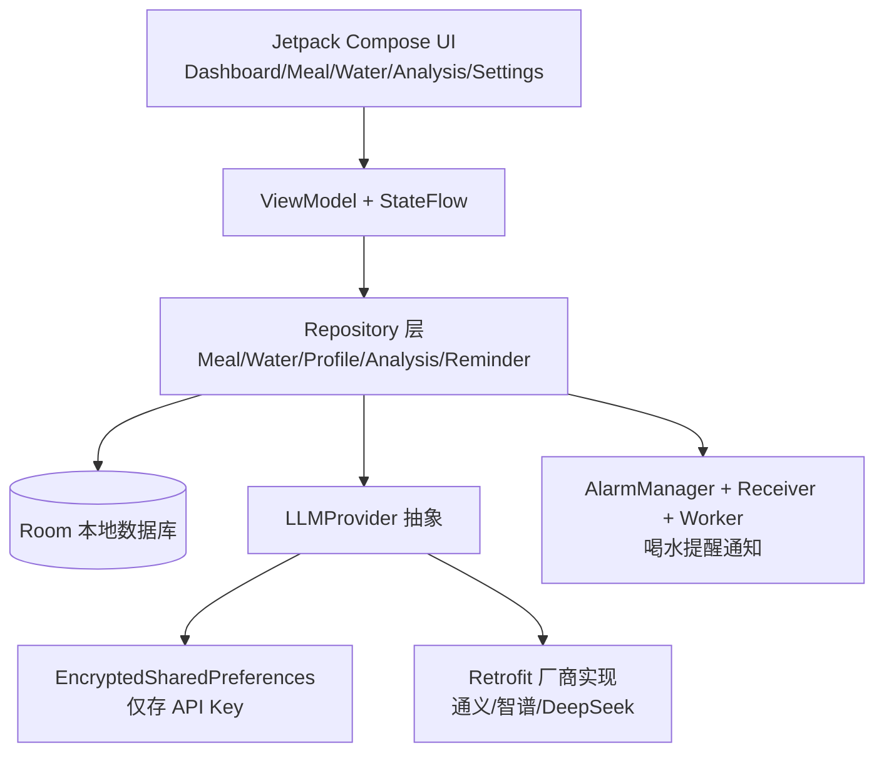

## 用户需求

开发一款仅面向 Android 的本地优先饮食管理 App，接入国内大模型 API 对一日三餐进行营养与热量分析，记录目标体重与每日热量摄入并对比目标，给出建议食物；支持可自定义的喝水提醒与每日饮水量记录，奶茶类饮品同时计算热量与水分。数据本地存储并支持导出/备份，每餐拍摄图片仅用于分析不持久化。好友系统放到后续版本，本期不做。

## 产品概览

单机版饮食管理工具：用户在首页查看当日热量摄入与饮水进度，记录早/中/晚餐（文字或拍照送大模型分析），查看大模型给出的三餐分析与建议食物，记录饮水量并设置自定义喝水提醒；在设置页维护个人资料、目标体重、大模型 API Key 与数据导出。整体本地运行，隐私可控。

## 核心功能

- 个人资料与目标设置：性别、年龄、身高、当前体重、目标体重、活动量，自动推算每日热量目标
- 三餐记录与 AI 分析：文字或拍照（图片不保存）记录早/中/晚，调用大模型解析热量、蛋白、碳水、脂肪并汇总
- 每日热量追踪：当日摄入 vs 目标可视化，支持体重记录与曲线
- 喝水记录与提醒：记录各类饮品容量与热量，奶茶同算热量与水分；可自定义提醒时间点与频次，系统通知提醒
- 建议食物与分析：基于三餐与目标，由大模型给出改善建议与推荐食物
- 设置与数据导出：API Key 加密存储、提醒管理、本地数据 JSON 导出/导入备份

## 技术栈选型

- 语言与 UI：Kotlin + Jetpack Compose + Material Design 3（Material You 动态取色）
- 架构：MVVM（ViewModel + StateFlow）+ Repository + 单向数据流；依赖注入用 Hilt
- 导航：Navigation Compose（单 Activity 多 Composable 页面）
- 本地数据：Room（SQLite）+ kotlinx.coroutines flow；偏好用 DataStore / EncryptedSharedPreferences（仅存 API Key）
- 网络与 AI：Retrofit + kotlinx.serialization，封装统一 `LLMProvider` 接口，支持通义/智谱/DeepSeek 可切换；请求结构化 JSON 输出便于解析
- 相机：CameraX 采集图片转字节流直接送分析，不写持久存储
- 提醒：AlarmManager（精确闹钟，Android 12+ 申请 `SCHEDULE_EXACT_ALARM`）+ WorkManager 兜底 + 本地通知（NotificationCompat）
- 工程：Gradle Kotlin DSL，模块化包结构

## 实现思路

- 采用"本地优先 + 可插拔 AI 接入层"策略：所有业务数据存本地 Room，AI 调用通过统一接口抽象，默认实现可在设置中切换厂商，API Key 由用户录入并加密保存，离线或异常时给出兜底提示，不影响本地记录。
- 关键决策：(1) 用统一 `LLMProvider` 接口隔离厂商差异，新增厂商只需加一个实现类，符合开闭原则；(2) 强制模型返回 JSON（JSON mode / function calling）以降低解析失败率；(3) 图片仅驻留内存并即时释放，避免占用存储；(4) 提醒用 AlarmManager 精确闹钟配合 WorkManager 重试，保证开机后可靠触发；(5) 用 Hilt 统一注入，降低耦合。

## 性能与可靠性

- 数据库查询以日期索引，配合 flow 增量更新，避免全表扫描与重复重组（recomposition）开销。
- 大模型调用为网络热点：采用超时、重试与结果缓存（当日已分析餐次不重复调用），避免重复请求与账单浪费。
- 提醒调度在应用进程外由系统广播触发，进程被杀仍能提醒；重启后由 BootReceiver 重新注册。
- 导出/导入用流式 JSON 序列化，避免大对象一次性驻留内存。

## 实现要点（防回归）

- 复用 Material 3 组件与统一主题，避免重复造 UI；新增页面遵循既有 NavGraph 路由约定。
- 日志使用 Android `Log` 并分级，绝不打印 API Key 与用户隐私；AI 调用失败仅记录简短错误码。
- API Key 必须存于 `EncryptedSharedPreferences`，禁止硬编码或明文 `DataStore`。
- 拍照分析流程结束后立即 `recycle()` Bitmap 并清空引用，防止内存泄漏。
- 保持 v1 不含账号/云端/好友，相关接口预留扩展点但不实现。

## 架构设计



数据流：用户交互 → ViewModel 处理 → Repository 协调本地 Room 与 AI 接入 → UI 通过 StateFlow 订阅更新；提醒由系统闹钟经 BroadcastReceiver 唤起通知。

## 目录结构

```
app/
├── build.gradle.kts                 # [MODIFY] 声明 Compose/Hilt/Room/CameraX/WorkManager 等依赖与插件
└── src/main/
    ├── AndroidManifest.xml          # [MODIFY] 声明相机、精确闹钟、开机广播、网络权限与 Receiver
    ├── java/com/example/diet/
    │   ├── DietApp.kt               # [NEW] Application 入口，初始化 Hilt 与依赖
    │   ├── data/
    │   │   ├── local/
    │   │   │   ├── AppDatabase.kt   # [NEW] RoomDatabase 定义与迁移策略
    │   │   │   ├── entity/          # [NEW] UserProfile/WeightRecord/MealRecord/WaterRecord/ReminderSetting 实体
    │   │   │   └── dao/             # [NEW] 各实体 Dao，按日期索引查询
    │   │   ├── remote/
    │   │   │   ├── LLMProvider.kt   # [NEW] 统一 AI 接口与分析/建议方法
    │   │   │   ├── model/           # [NEW] 请求/响应 DTO 与结构化结果模型
    │   │   │   └── provider/        # [NEW] TongyiProvider/ZhipuProvider/DeepSeekProvider 实现
    │   │   └── repository/          # [NEW] Meal/Water/Profile/Analysis/Reminder 仓库，封装数据来源
    │   ├── di/                      # [NEW] DatabaseModule/NetworkModule/RepositoryModule 注入配置
    │   ├── domain/                  # [NEW] 业务模型与计算（BMR/TDEE、目标热量、奶茶热量水分）
    │   ├── ui/
    │   │   ├── theme/               # [NEW] Color/Theme/Type，Material You 动态配色
    │   │   ├── navigation/          # [NEW] NavGraph 与 Routes 常量
    │   │   ├── dashboard/           # [NEW] 首页仪表盘 Screen + ViewModel
    │   │   ├── meal/                # [NEW] 三餐记录/拍照分析 Screen + ViewModel
    │   │   ├── water/               # [NEW] 喝水记录/奶茶/提醒设置 Screen + ViewModel
    │   │   ├── analysis/            # [NEW] 分析与建议 Screen + ViewModel
    │   │   └── settings/            # [NEW] 资料/目标/API Key/导出 Screen + ViewModel
    │   ├── receiver/                # [NEW] ReminderBroadcastReceiver 与 BootReceiver
    │   ├── worker/                  # [NEW] ReminderWorker 兜底调度
    │   └── util/                    # [NEW] 权限申请、JSON 导出导入、相机辅助、通知构建
    └── res/                         # [NEW] strings/colors/themes 与各页面排版资源
```

## 关键代码结构

```
interface LLMProvider {
    val id: String
    suspend fun analyzeMeal(req: MealAnalysisRequest): Result<MealAnalysis>
    suspend fun suggestFoods(req: FoodSuggestionRequest): Result<List<FoodSuggestion>>
}

data class MealAnalysis(
    val caloriesKcal: Int,
    val proteinG: Float,
    val carbG: Float,
    val fatG: Float,
    val summary: String
)

data class WaterRecord(
    val type: DrinkType,        // WATER / TEA / MILK_TEA / COFFEE / OTHER
    val volumeMl: Int,
    val caloriesKcal: Int,      // 奶茶/含糖饮品 > 0；纯水 = 0
    val isMilkTea: Boolean      // 同时计入热量与水分
)
```

## 设计风格

采用清爽健康风（Material You 动态取色 + 柔和渐变 + 圆角卡片 + 微动效）。以青绿为主色调传递"健康、自然、可控"，首页用进度环与圆形水波动效增强成就感；页面统一顶部标题栏 + 底部导航（首页/记录/分析/设置），卡片化信息展示，点击与状态切换带轻微缩放与色彩过渡。整体留白充足、可读性高，适配安卓手机竖屏。

## 页面规划

1. 首页仪表盘：当日热量进度环、饮水进度、快速记录入口、体重趋势小图
2. 三餐记录：早/中/晚切换、文字输入、拍照分析、已记录营养卡片
3. 喝水记录：一键加水、饮品类型选择、奶茶热量水分同记、自定义提醒设置
4. 分析与建议：大模型三餐分析摘要、与目标对比、推荐食物列表
5. 设置：个人资料/目标体重、API Key 录入、数据导出导入、提醒总开关

## 单页区块设计

### 首页仪表盘

- 顶部栏：应用名 + 日期 + 设置入口（不超过 60 字）
- 热量进度环：环形进度展示当日摄入/目标，中心显示剩余热量，配微动效
- 饮水进度卡：水波动画显示饮水量/目标，一键"喝一杯"快捷按钮
- 快捷记录：早/中/晚三个入口卡片，显示是否已记录
- 底部导航：首页/记录/分析/设置 四个 tab，选中态高亮

### 三餐记录页

- 顶部栏：标题"三餐记录" + 日期切换
- 餐次切换：早/中/晚分段按钮，选中态主色填充
- 录入区：文字描述输入框 + 拍照按钮（图标动效），提交后调用分析
- 营养卡片：分析返回的热量/蛋白/碳水/脂肪条形展示
- 底部导航：同全局，保持一致性

### 喝水记录页

- 顶部栏：标题"喝水" + 提醒设置入口
- 饮品类型：水/茶/咖啡/奶茶/其他 图标网格，选中高亮
- 容量输入：快捷 200/300/500ml 与圆滑块，奶茶自动显示热量
- 今日记录：时间线列表，可删除单条
- 提醒设置：时间点增删列表 + 总开关（独立区块，可下钻）

### 分析与建议页

- 顶部栏：标题"分析与建议"
- 总览卡：当日热量 vs 目标对比，达标/超额状态色
- AI 分析：大模型返回的三餐文字分析与评分
- 建议食物：横向卡片列表，含热量标签，可点击查看
- 底部导航：同全局

### 设置页

- 顶部栏：标题"设置"
- 个人资料：性别/年龄/身高/体重/活动量表单，自动算目标
- API 配置：厂商选择 + Key 录入（密文显示），连接测试
- 数据管理：导出/导入 JSON 按钮，展示上次备份时间